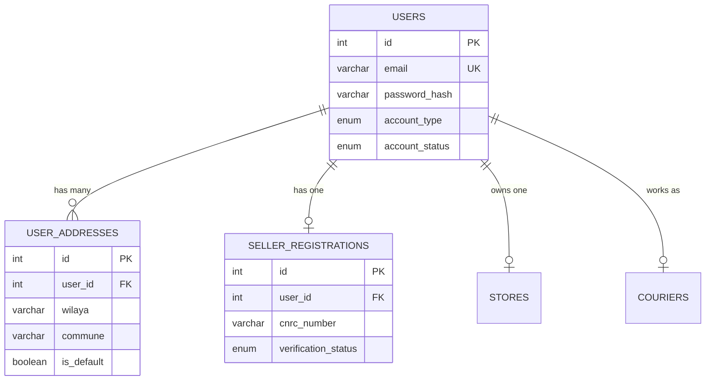
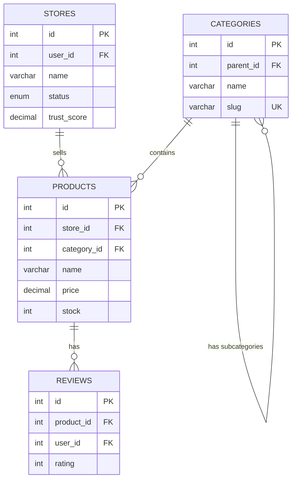
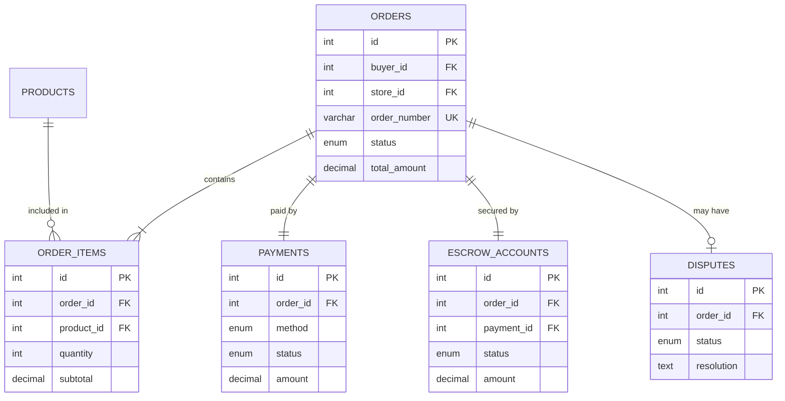
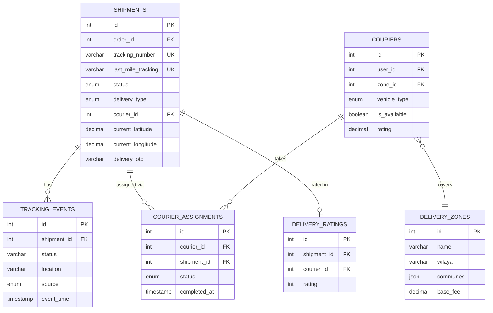

# Entity-Relationship Diagram

## Algérie Poste E-Commerce Database

This document contains the complete ER diagrams for the database using Mermaid syntax.

---

## Complete ER Diagram

```mermaid
erDiagram
    %% ==========================================
    %% USERS MODULE
    %% ==========================================
    
    USERS {
        int id PK
        varchar email UK
        varchar password_hash
        varchar full_name
        varchar phone
        text bio
        enum account_type "buyer|seller|both"
        enum account_status "active|inactive|pending|suspended"
        varchar language_preference
        timestamp last_login
        timestamp created_at
        timestamp updated_at
    }
    
    USER_ADDRESSES {
        int id PK
        int user_id FK
        varchar name
        varchar full_name
        varchar phone
        varchar wilaya
        varchar commune
        varchar street
        varchar postal_code
        boolean is_default
        enum address_type "shipping|billing|both"
        timestamp created_at
        timestamp updated_at
    }
    
    SELLER_REGISTRATIONS {
        int id PK
        int user_id FK
        varchar full_name
        varchar ssid
        varchar business_id
        varchar cnrc_number
        varchar document1_path
        varchar document2_path
        varchar document3_path
        enum verification_status "pending|approved|rejected"
        timestamp verified_at
        int verified_by FK
        text rejection_reason
        timestamp created_at
        timestamp updated_at
    }
    
    %% ==========================================
    %% STORES & PRODUCTS MODULE
    %% ==========================================
    
    STORES {
        int id PK
        int user_id FK
        varchar name
        enum status "active|draft|suspended"
        varchar location
        varchar wilaya
        text description
        int theme_id FK
        varchar domain
        varchar logo_path
        varchar banner_path
        decimal trust_score
        int total_sales
        timestamp created_at
        timestamp updated_at
    }
    
    THEMES {
        int id PK
        varchar name
        text description
        varchar preview_image
        boolean is_active
        timestamp created_at
    }
    
    CATEGORIES {
        int id PK
        varchar name
        varchar slug UK
        int parent_id FK
        text description
        varchar image_path
        boolean is_active
        int sort_order
        timestamp created_at
    }
    
    PRODUCTS {
        int id PK
        int store_id FK
        int category_id FK
        varchar name
        varchar slug UK
        text description
        decimal price
        decimal compare_price
        int stock
        varchar sku
        enum status "active|draft|sold_out"
        json images
        json attributes
        decimal weight
        json dimensions
        int total_sold
        decimal rating
        int review_count
        timestamp created_at
        timestamp updated_at
    }
    
    REVIEWS {
        int id PK
        int product_id FK
        int user_id FK
        int order_id FK
        int rating
        text comment
        json images
        boolean is_verified
        timestamp created_at
        timestamp updated_at
    }
    
    %% ==========================================
    %% ORDERS MODULE
    %% ==========================================
    
    ORDERS {
        int id PK
        int buyer_id FK
        int store_id FK
        varchar order_number UK
        enum status "pending|confirmed|processing|shipped|delivered|cancelled|returned"
        decimal subtotal
        decimal shipping_fee
        decimal discount
        decimal total_amount
        json shipping_address
        json billing_address
        text notes
        timestamp confirmed_at
        timestamp shipped_at
        timestamp delivered_at
        timestamp created_at
        timestamp updated_at
    }
    
    ORDER_ITEMS {
        int id PK
        int order_id FK
        int product_id FK
        varchar product_name
        decimal product_price
        int quantity
        decimal subtotal
        json product_snapshot
        timestamp created_at
    }
    
    %% ==========================================
    %% PAYMENTS MODULE
    %% ==========================================
    
    PAYMENTS {
        int id PK
        int order_id FK
        enum method "ccp|baridi_mob|edahabia|cash_on_delivery"
        decimal amount
        enum status "pending|completed|failed|refunded"
        varchar transaction_id
        varchar ccp_account
        varchar ccp_receipt_path
        json payment_details
        timestamp completed_at
        timestamp created_at
        timestamp updated_at
    }
    
    ESCROW_ACCOUNTS {
        int id PK
        int order_id FK
        int payment_id FK
        decimal amount
        enum status "pending|locked|released|disputed|refunded"
        timestamp locked_at
        timestamp releasable_at
        timestamp released_at
        timestamp created_at
        timestamp updated_at
    }
    
    DISPUTES {
        int id PK
        int order_id FK
        int escrow_id FK
        int raised_by FK
        enum type "not_received|wrong_item|damaged|other"
        enum status "open|investigating|resolved|closed"
        text description
        json evidence
        text resolution
        int resolved_by FK
        timestamp resolved_at
        timestamp created_at
        timestamp updated_at
    }
    
    %% ==========================================
    %% LOGISTICS MODULE
    %% ==========================================
    
    SHIPMENTS {
        int id PK
        int order_id FK
        varchar tracking_number UK
        varchar last_mile_tracking UK
        enum provider "ems_standard|ems_express|colis"
        enum status "pending|label_created|picked_up|in_transit|at_bureau|out_for_delivery|delivered|failed_delivery|returned"
        enum delivery_type "bureau_pickup|home_delivery|relay_point"
        int courier_id FK
        varchar courier_name
        varchar courier_phone
        decimal current_latitude
        decimal current_longitude
        timestamp last_location_update
        varchar label_url
        decimal weight
        json dimensions
        json sender_address
        json recipient_address
        varchar destination_bureau
        timestamp bureau_arrival_time
        date estimated_delivery
        timestamp actual_delivery
        varchar delivery_signature
        varchar delivery_photo
        varchar recipient_name_confirmed
        int delivery_attempts
        int max_delivery_attempts
        json preferred_time_slot
        varchar delivery_otp
        timestamp otp_expires_at
        timestamp created_at
        timestamp updated_at
    }
    
    TRACKING_EVENTS {
        int id PK
        int shipment_id FK
        varchar status
        varchar location
        decimal latitude
        decimal longitude
        enum source "algerie_poste|internal|courier_app"
        text description
        timestamp event_time
        timestamp created_at
    }
    
    COURIERS {
        int id PK
        int user_id FK
        int zone_id FK
        varchar full_name
        varchar phone
        varchar email
        enum vehicle_type "motorcycle|car|van|bicycle"
        varchar license_number
        varchar id_document_path
        decimal current_latitude
        decimal current_longitude
        timestamp last_location_update
        boolean is_active
        boolean is_available
        decimal rating
        int total_deliveries
        timestamp created_at
        timestamp updated_at
    }
    
    COURIER_ASSIGNMENTS {
        int id PK
        int courier_id FK
        int shipment_id FK
        enum status "assigned|accepted|picked_up|in_transit|delivered|failed|cancelled"
        timestamp assigned_at
        timestamp accepted_at
        timestamp picked_up_at
        timestamp completed_at
        text notes
        timestamp created_at
        timestamp updated_at
    }
    
    DELIVERY_ZONES {
        int id PK
        varchar name
        varchar wilaya
        json communes
        decimal base_fee
        decimal per_km_fee
        int estimated_time_minutes
        boolean is_active
        timestamp created_at
        timestamp updated_at
    }
    
    DELIVERY_RATINGS {
        int id PK
        int shipment_id FK
        int courier_id FK
        int user_id FK
        int rating
        text comment
        json tags
        timestamp created_at
    }
    
    %% ==========================================
    %% REFERENCE & CONFIG TABLES
    %% ==========================================
    
    WILAYAS {
        int id PK
        varchar code UK
        varchar name_ar
        varchar name_fr
        enum shipping_zone "zone1|zone2|zone3"
        timestamp created_at
    }
    
    PLANS {
        int id PK
        varchar name
        text description
        decimal price
        enum billing_period "monthly|yearly"
        json features
        int max_products
        int max_orders
        decimal commission_rate
        boolean is_active
        timestamp created_at
        timestamp updated_at
    }
    
    SUBSCRIPTIONS {
        int id PK
        int store_id FK
        int plan_id FK
        enum status "active|cancelled|expired"
        timestamp starts_at
        timestamp ends_at
        timestamp cancelled_at
        timestamp created_at
        timestamp updated_at
    }
    
    NOTIFICATIONS {
        int id PK
        int user_id FK
        varchar type
        varchar title
        text message
        json data
        boolean is_read
        timestamp read_at
        timestamp created_at
    }
    
    AUDIT_LOGS {
        int id PK
        int user_id FK
        varchar action
        varchar entity_type
        int entity_id
        json old_values
        json new_values
        varchar ip_address
        text user_agent
        timestamp created_at
    }
    
    %% ==========================================
    %% RELATIONSHIPS
    %% ==========================================
    
    USERS ||--o{ USER_ADDRESSES : "has"
    USERS ||--o| SELLER_REGISTRATIONS : "registers as seller"
    USERS ||--o| STORES : "owns"
    USERS ||--o{ ORDERS : "places"
    USERS ||--o{ REVIEWS : "writes"
    USERS ||--o{ DISPUTES : "raises"
    USERS ||--o{ NOTIFICATIONS : "receives"
    USERS ||--o{ AUDIT_LOGS : "generates"
    USERS ||--o| COURIERS : "works as"
    
    STORES ||--o{ PRODUCTS : "sells"
    STORES ||--o{ ORDERS : "receives"
    STORES }o--|| THEMES : "uses"
    STORES ||--o{ SUBSCRIPTIONS : "subscribes to"
    
    CATEGORIES ||--o{ PRODUCTS : "contains"
    CATEGORIES ||--o{ CATEGORIES : "parent of"
    
    PRODUCTS ||--o{ ORDER_ITEMS : "ordered in"
    PRODUCTS ||--o{ REVIEWS : "reviewed in"
    
    ORDERS ||--|{ ORDER_ITEMS : "contains"
    ORDERS ||--|| PAYMENTS : "paid by"
    ORDERS ||--|| ESCROW_ACCOUNTS : "held in"
    ORDERS ||--o| SHIPMENTS : "shipped via"
    ORDERS ||--o{ DISPUTES : "disputed in"
    
    PAYMENTS ||--|| ESCROW_ACCOUNTS : "funds"
    
    SHIPMENTS ||--o{ TRACKING_EVENTS : "tracked by"
    SHIPMENTS ||--o| COURIERS : "delivered by"
    SHIPMENTS ||--o{ COURIER_ASSIGNMENTS : "assigned to"
    SHIPMENTS ||--o| DELIVERY_RATINGS : "rated in"
    
    COURIERS ||--o{ COURIER_ASSIGNMENTS : "takes"
    COURIERS }o--|| DELIVERY_ZONES : "covers"
    COURIERS ||--o{ DELIVERY_RATINGS : "receives"
    
    PLANS ||--o{ SUBSCRIPTIONS : "purchased as"
```



---

## Module-Specific Diagrams

### Users Module



### Commerce Module



### Orders & Payments Module



### Logistics Module



---

## Cardinality Summary

| Relationship | Type | Description |
|--------------|------|-------------|
| User → Addresses | 1:N | One user has many addresses |
| User → Store | 1:1 | One seller has one store |
| User → Orders | 1:N | One buyer has many orders |
| Store → Products | 1:N | One store sells many products |
| Category → Products | 1:N | One category contains many products |
| Category → Subcategories | 1:N | Self-referencing hierarchy |
| Order → Items | 1:N | One order has many items |
| Order → Payment | 1:1 | One order has one payment |
| Order → Escrow | 1:1 | One order has one escrow account |
| Order → Shipment | 1:1 | One order has one shipment |
| Shipment → Events | 1:N | One shipment has many tracking events |
| Shipment → Courier | N:1 | Many shipments assigned to one courier |
| Courier → Zone | N:1 | Many couriers work in one zone |

---

## How to Render

### GitHub/GitLab
Mermaid diagrams render automatically in markdown files.

### VS Code
Install the "Markdown Preview Mermaid Support" extension.

### Online
Use [Mermaid Live Editor](https://mermaid.live/) to render and export as PNG/SVG.

### Export to Image
```bash
# Using mermaid-cli
npm install -g @mermaid-js/mermaid-cli
mmdc -i ER_DIAGRAM.md -o er-diagram.png
```
